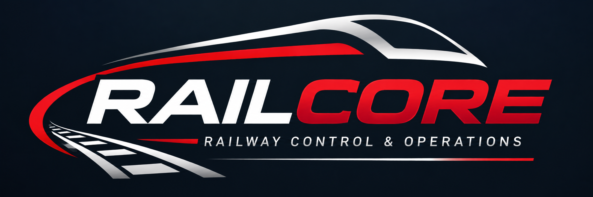

# RailCore

**Railway Control & Operations**

Eigene Modellbahn-Steuerung (Java 25) für Roco Z21 mit Z21 Detector 10808 (CAN, RailCom).

Stand: Grundgerüst des Kerns (Meilenstein 1, in Arbeit) – noch nicht lauffähig als Programm.

## Inhalt
- `src/main/java/at/schmoegl/railcore/core` – Zentralen-Schnittstelle (Hardware-Abstraktion)
- `.../z21` – Z21-Treiber: Fahren, Funktionen, Weichen, R-Bus, CAN-Melder mit RailCom, CV/POM
- `.../layout` – Gleisplan-Modell und JSON-Lader
- `.../train` – Fahrprofil, Fahrmodell, Positionsmodell
- `.../safety` – Zustandsautomat, Watchdog, Melder-Filter
- `.../diag` – Ereignisprotokoll
- `docs/FEATURES.md` – Anforderungsübersicht
- `docs/ENTSCHEIDUNGEN.md` – Entscheidungsprotokoll

Das vollständige technische Lastenheft liegt als Dokument „RailCore – Technisches Lastenheft“ in claude.ai.

## Bauen
Voraussetzung: JDK 25 (z. B. Eclipse Temurin 25). Gradle wird über den Wrapper geladen (`gradlew.bat build`), sobald er eingerichtet ist.

    gradle build
